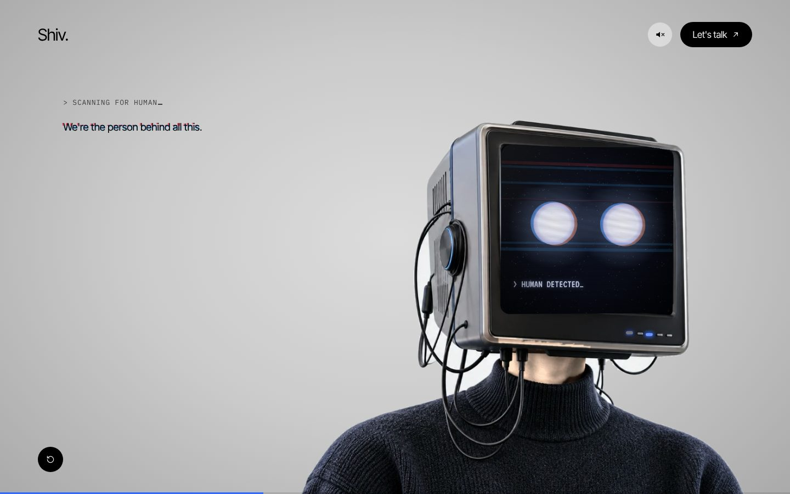

# Portfolio

Personal portfolio of Shivanand Shukla. The hero is a CRT-headed character that follows your cursor, boots up when you click, and talks to you through his screen.




## Deploy on Vercel (one time)

1. Go to [vercel.com/new](https://vercel.com/new) and sign in with GitHub.
2. Import the `XS-Shiv/Portfolio` repository. Vercel detects Next.js; keep every default.
3. Click **Deploy**. Every push to `main` then redeploys the live site, and every other branch gets its own preview link.

No environment variables are needed.

## Change the words

Everything the site says lives in [`src/hero/content.ts`](src/hero/content.ts): the signature, the contact links, the screen text and the whole conversation.

The conversation is a small graph. Each entry in `dialogue` has:

- `system`: the small terminal line at the top (the machine's voice)
- `lines`: what Shiv says, typed in order. The newest is large; the one before it small and faded
- `sub`: the subtext under the large line
- `screen`: the caption under the eyes on the monitor
- `options`: the replies. The **first is the main call to action** (the big dark card); the rest are minor rows

An option can go to another node (`next`), open a link (`href`) or open the contact panel (`action: "connect"`). Options with a `topic` fill the progress bar and light one more LED under the screen.

### The "I → we" glitch

A line can carry a `slip` (the same sentence, but "we") and a `recovery`. It types normally, tears into the slip for a moment, then is replaced by the recovery, as if nothing happened. Mark it `once` so it plays only on the first visit. There are three on purpose; more and it becomes a gimmick.

## Change the pictures on the screen

Before anyone clicks, the screen flashes pictures for a few seconds, broadcast in CRT colours with glitches. They are listed in `screen.images` in `src/hero/content.ts`. Put your own photos in `public/screen/` and add their paths there; `pixel:heart`, `pixel:bulb`, `pixel:spark` and `pixel:hi` are built in.

## Change the timing

Every duration (nudges, typing speed, the glitch, the slide, blinks, the head's lag) and how much the body follows the head is a named constant in [`src/hero/timings.ts`](src/hero/timings.ts).

## Run it locally

```bash
npm install
npm run dev        # http://localhost:3000
npm run build      # production build, what Vercel runs
```

Add `?nowebgl` to the URL to see the photo fallback that browsers without WebGL get.

## How it fits together

| Path | What it does |
|---|---|
| `src/hero/Hero.tsx` | The page: state machine wiring, conversation column, chrome, controls |
| `src/hero/machine.ts` | Explicit states: `idle → booting → conversation`, plus `restarting` |
| `src/hero/screen/engine.ts` | Draws the monitor screen live on a canvas: stars, text, caret, flicker, power-on, the face |
| `src/hero/character/Character.tsx` | The one `<Character />` interface: photo first, then the 3D head |
| `src/hero/character/Crt3D.tsx` | The procedural 3D monitor (React Three Fiber). Swap for a GLB here |
| `src/hero/sound.ts` | Ambient room tone, power-on hum, key clicks and the glitch blip, synthesised with WebAudio, off until the top-bar speaker is pressed |
| `scripts/make_plates.py` | Rebuilds `public/character/body.*` and `front-blank.*` from `front.png` |

Details: [requirements](docs/plans/2026-10-20-1931-feat-crt-hero-plan.md), [visual direction](docs/design/hero-direction.md), [lessons learned](docs/learnings.md).

## Notes

- **First paint.** The page paints the photo of the character immediately, then loads the 3D head (about 240 KB gzipped) in the background and crossfades to it. The first-paint JavaScript is about 220 KB gzipped, most of which is the Next.js and React runtime itself.
- **Reduced motion.** With "reduce motion" on, the head holds still, the character jumps instead of sliding, and text appears at once.
- **First-paint photo.** The photo that paints before the 3D head (and the no-WebGL fallback) still shows the original silver monitor. On a normal laptop the slimmer dark grey 3D head replaces it within about a second.
- **Better assets.** A taller `body.png` (sweater from the jawline to mid-torso, transparent background) would let the sweater reach the bottom of tall phones without the stretched strip at the very bottom. Drop it in `public/character/` and rerun the script, or ask Claude to wire it in.
