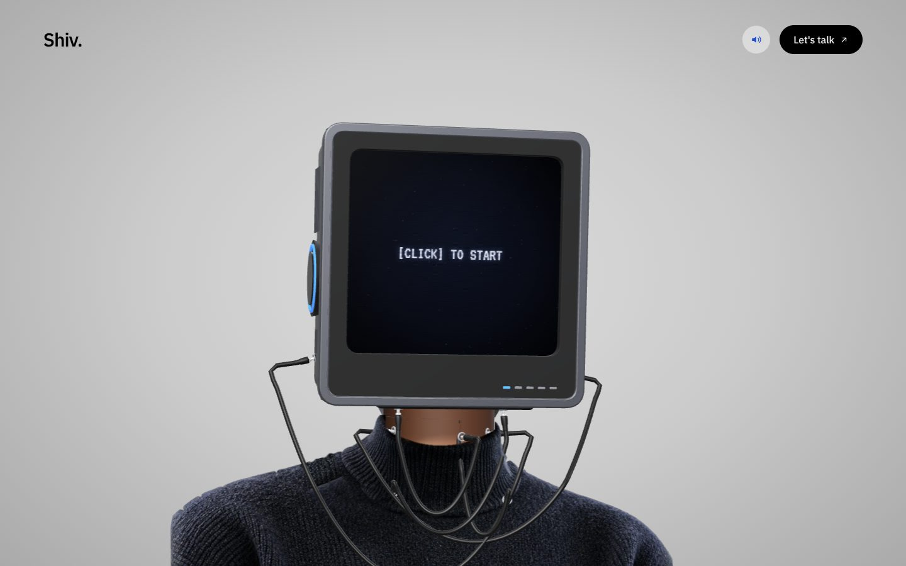
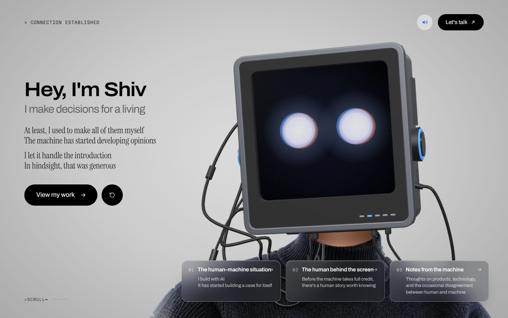
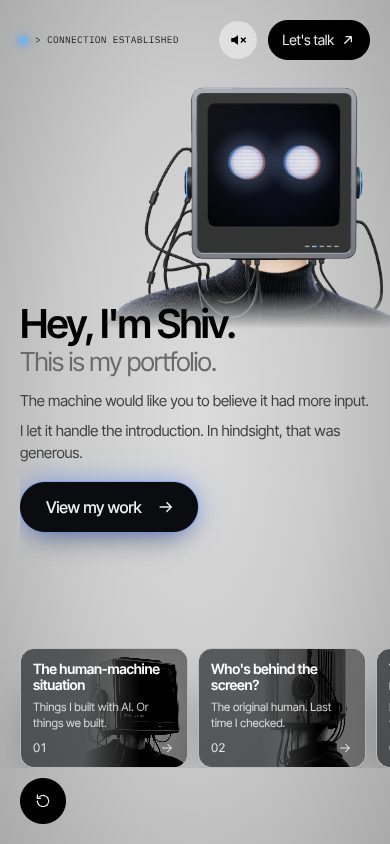

# Portfolio

Personal portfolio of Shivanand Shukla. The hero is a CRT-headed character that follows your cursor, boots up when you click, and talks to you through his screen.





## Deploy on Vercel (one time)

1. Go to [vercel.com/new](https://vercel.com/new) and sign in with GitHub.
2. Import the `XS-Shiv/Portfolio` repository. Vercel detects Next.js; keep every default.
3. Click **Deploy**. Every push to `main` then redeploys the live site, and every other branch gets its own preview link.

No environment variables are needed.

## Change the words

Everything the site says lives in [`src/hero/content.ts`](src/hero/content.ts): the status line, the State 2 introduction, the three cards, the section each card opens, and the contact links. The copy has no full stops on purpose; where a line holds two sentences, `\n` puts them on two lines.

## His voice

Every line in `intro.lines` and `intro.body` is spoken while its words appear. Each line can carry a `spoken` version that shapes delivery without changing the screen (` / ` is a short beat, ` // ` a long pause before a punchline). Lines are split into one clip per phrase; the pauses between clips (`VOICE.beat`, `VOICE.sentence`, `VOICE.punchline` in `timings.ts`) are added at playback, so changing them needs no regeneration.

The clips are made with Sarvam AI's Bulbul TTS (Indian English):

1. Get an API key at [dashboard.sarvam.ai](https://dashboard.sarvam.ai) (new accounts get free credits; the whole intro is under 300 characters).
2. Put it in `.env.local` (never committed): `SARVAM_API_KEY=...`
3. Audition voices: `npx tsx scripts/generate-voice.ts --audition shubh,aditya,rahul,kabir` writes `voice-audition/<name>.mp3` (the full intro with real pauses).
4. Set `VOICE.speaker` in `timings.ts` to your pick, then `npx tsx scripts/generate-voice.ts`.

Only phrases whose text or voice settings changed are regenerated; unused clips are deleted. Needs ffmpeg. Until a phrase has a clip, its line is read by the visitor's browser voice. Sound is on by default (browsers start it on the first click); the speaker in the top bar mutes everything and is remembered.

## How State 2 works

- One screen, never scrolls, at any size. The type scale follows the smaller of width and height.
- The lines are revealed word by word with the voice. The main button, restart and the three cards arrive after the second line and pulse with his voice. Clicking the text finishes the current line.
- "View my work" and the cards open their section in place of the introduction, with a Back button. Restart returns to State 1.
- Every 9 to 14 seconds the headline's "I'm" glitches to "we're", holds for 1.8 s, flickers as he notices, and glitches back (text only; the voice says "I'm"). Timing in `timings.ts`.
- On phones the cards are a compact stack; add `?cards=row` to preview them as a horizontal snap row.

## Type

IBM Plex Sans for Shiv's lines and IBM Plex Mono for system lines (the screen keeps VT323), self-hosted through `next/font`. Two other pairings are ready: add `?font=geist` or `?font=inter` to the URL to preview them, and change `PAIRING` in [`app/fonts.ts`](app/fonts.ts) to switch.

## Music

The background track is `public/audio/the-mountain.mp3` ("The Mountain", 96 seconds, looped). It starts with the visitor's first click, fades in, and ducks under his voice. The level is `MUSIC_LEVEL` in [`src/hero/sound.ts`](src/hero/sound.ts).

## Change the pictures on the screen

Before anyone clicks, the screen flashes pictures for a few seconds, broadcast in CRT colours with glitches. They are listed in `screen.images` in `src/hero/content.ts`. Put your own photos in `public/screen/` and add their paths there; `pixel:heart`, `pixel:bulb`, `pixel:spark` and `pixel:hi` are built in.

## Work

"View my work" and card 01 go to `/work` (a short CRT exit, then the page). Coming back, with the browser's back button or a link home, lands on State 2 already settled; a fresh visit or a reload starts at State 1.

- Each piece of work is one Markdown file in [`content/work/`](content/work/README.md). Adding a file adds a card and a page at `/work/<slug>`; no component changes.
- Tabs appear on their own: a tab needs at least two published items (`MIN_ITEMS_PER_TAB`), Featured needs one, and Playground is off (`SHOW_PLAYGROUND`). Tab names, the page's words and these rules are in [`src/work/config.ts`](src/work/config.ts).
- New items are `status: draft`: they never appear in production. With `npm run dev`, tick "Show drafts" on /work to preview them. A published item may not contain "TODO" (the build fails and names the file).
- Covers go in `public/work/<slug>/`; until then an item borrows one of the monitor photos.
- The Work pages scroll, and load no 3D or voice code.

## Change the timing and the motion

Every duration (nudges, the glitch, the slide, blinks) is in `T`, every head, neck and torso spring and range in `MOTION`, and the cords' thickness and physics in `CABLE`, all in [`src/hero/timings.ts`](src/hero/timings.ts). To tune the motion live, run `npm run dev` and open `http://localhost:3000/?tune`: a panel with a slider for every constant (not part of production builds). `?pose=40,18` holds the head at a fixed yaw and pitch, for checking extremes.

## Run it locally

```bash
npm install
npm run dev        # http://localhost:3000
npm run build      # production build, what Vercel runs
```

Add `?nowebgl` to the URL to see the photo fallback that browsers without WebGL get.

## How it fits together

| Path | What it does |
|---|---|
| `src/hero/Hero.tsx` | The page: state machine wiring, conversation column, chrome, controls |
| `src/hero/machine.ts` | Explicit states: `idle → booting → conversation`, plus `restarting` |
| `src/hero/pronouns.ts` | The I <-> we flip: which words swap and how |
| `src/hero/screen/engine.ts` | Draws the monitor screen live on a canvas: stars, text, caret, flicker, power-on, the face |
| `src/hero/character/Character.tsx` | The one `<Character />` interface: photo first, then the 3D head |
| `src/hero/character/Crt3D.tsx` | The 3D character: procedural monitor, bending neck, 2.5D sweater, rope cords (React Three Fiber). Swap the monitor for a GLB here |
| `src/hero/character/physics.ts`, `springs.ts` | The rope and re-bendable tube for the cords; the spring helpers |
| `src/hero/voice.ts` | Speaks each line and reveals its words in time |
| `src/hero/sound.ts` | Music, the voice's analyser, mute, and the small effects |
| `app/work/`, `src/work/` | The /work listing and project pages, the content loader and its rules |
| `src/site/` | What the Work pages share with the hero: the top bar, the sound preference |
| `scripts/generate-voice.ts` | Makes the voice clips with Sarvam AI (or `--engine kokoro` offline placeholders) |
| `src/hero/speech.ts` | How a spoken line splits into phrase clips and pauses (shared by the script and the page) |
| `scripts/make_plates.py` | Rebuilds `public/character/body.*` from `front.png` (cords painted out) |
| `scripts/bake_still.py` | Bakes `front-blank.*`, the first-paint still of the 3D character |

Details: [requirements](docs/plans/2026-10-20-1931-feat-crt-hero-plan.md), [visual direction](docs/design/hero-direction.md), [lessons learned](docs/learnings.md).

## Notes

- **First paint.** The page paints a still of the 3D character immediately (also what browsers without WebGL keep), then loads the 3D scene in the background and crossfades to it, so nothing visibly swaps. The first-paint JavaScript is about 226 KB gzipped; voice clips load only once State 2 starts.
- **Reduced motion.** With "reduce motion" on, the head holds still, the character jumps instead of sliding, and text appears at once; the voice still reads the lines if sound is on.
- **Better assets.** A taller `body.png` (sweater from the jawline to mid-torso, transparent background) would let the sweater reach the bottom of tall phones without the stretched strip at the very bottom. Drop it in `public/character/` and rerun the script, or ask Claude to wire it in.
